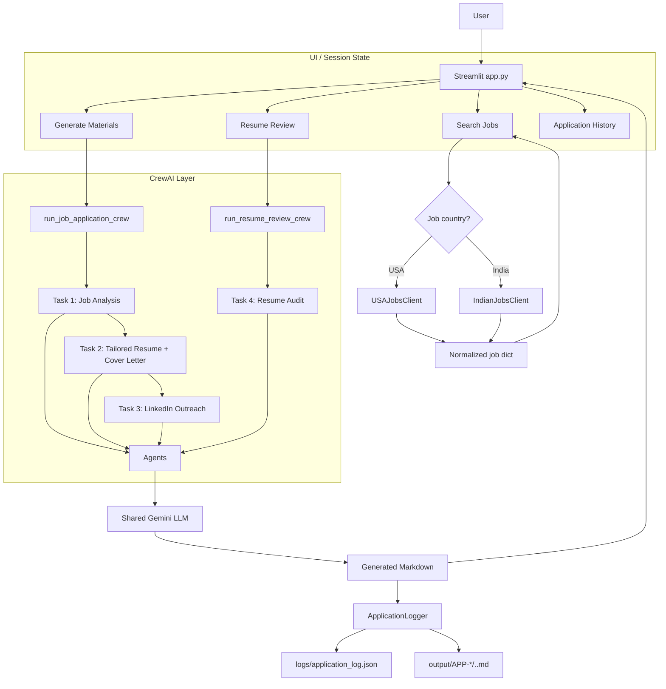
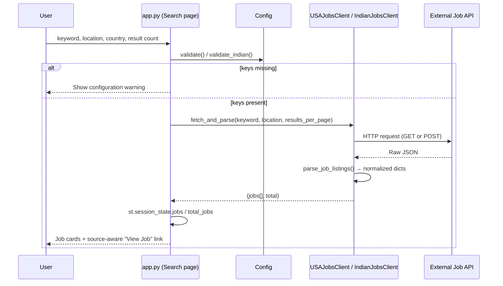
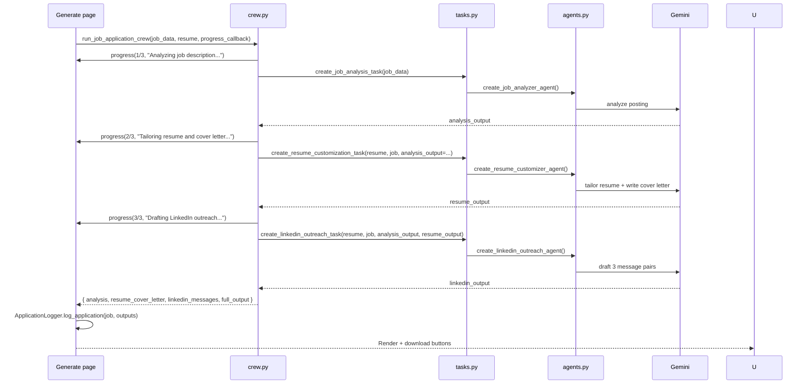

# Architecture — Multi-Agent Job Application Assistant

This document describes the current architecture of the application as implemented in the repository, including the stepwise CrewAI pipeline, dual job-source support (USA + India), and the standalone resume-review flow.

---

## 1. Overview

The application is a **Streamlit** web app that:

1. Searches real job postings from **USAJobs** (US federal jobs) or **Indian job providers** (Adzuna / JSearch / Jooble).
2. Lets the user upload or paste a resume.
3. Runs a **CrewAI** pipeline powered by **Google Gemini** to produce job analysis, a tailored resume + cover letter, and LinkedIn outreach messages.
4. Optionally runs a **standalone AI resume audit** with prioritized improvement feedback.
5. Persists every completed run to local JSON logs and Markdown output files.

The design follows a clean layering:

```
UI (Streamlit)  →  Job Source Clients  →  Task Definitions  →  Crew Orchestration  →  Agents (Gemini LLM)
       ↓                                                                                       ↓
 Session state                                                                          Generated outputs
       ↓                                                                                       ↓
 ApplicationLogger  →  logs/application_log.json  +  output/APP-<timestamp>/*.md
```

---

## 2. Technology Stack

| Layer | Technology |
|-------|-----------|
| UI | Streamlit |
| Agent framework | CrewAI (`crewai[google-genai]`) |
| LLM | Google Gemini via CrewAI `LLM` / LiteLLM |
| Job APIs | USAJobs API, Adzuna, JSearch (RapidAPI), Jooble |
| Resume parsing | `pypdf`, `python-docx`, plain text/Markdown/RTF decode |
| Config | `python-dotenv` + centralized `Config` class |
| HTTP | `requests` |
| Persistence | Local JSON log + Markdown files |
| Language | Python 3.10+ |

---

## 3. Module Map

| File | Responsibility |
|------|----------------|
| `app.py` | Streamlit UI, page router, session state, resume upload/extraction, progress rendering |
| `config.py` | Environment loading, centralized settings, provider selection, key validation |
| `usajobs_client.py` | USAJobs API client + normalization into the common job schema |
| `indian_jobs_client.py` | Indian job client with pluggable providers (Adzuna / JSearch / Jooble) + same normalized schema |
| `agents.py` | Four CrewAI agent factories + shared cached Gemini LLM |
| `tasks.py` | Task factories, prompt construction, input truncation helpers |
| `crew.py` | Stepwise crew execution, progress callbacks, error fallback, resume-review orchestration |
| `logger.py` | Persistent application history and generated-output file management |
| `requirements.txt` | Dependencies |
| `logs/` | `application_log.json` (runtime history) |
| `output/` | Per-run folders `APP-<timestamp>/` with generated Markdown |

> Note: `my_model.pkl` exists in the repo root but is not referenced by any runtime code. `pdfplumber` is listed in `requirements.txt` but is not currently used by the app (text extraction uses `pypdf` and `python-docx`).

---

## 4. High-Level Component Diagram



---

## 5. Request Flows

### 5.1 Job Search Flow



Both clients emit the same **normalized job schema**, so the rest of the app is source-agnostic:

| Key | Meaning |
|-----|---------|
| `title`, `organization`, `department`, `location` | Core listing identity |
| `salary`, `grade`, `open_date`, `close_date` | Metadata (provider-dependent accuracy) |
| `description`, `duties`, `qualifications` | Text consumed by the AI pipeline |
| `url`, `position_id` | Apply link and identifier |
| `source` | Provider name (Indian providers only; e.g. `adzuna`) |

### 5.2 AI Materials Generation Pipeline

`run_job_application_crew()` in `crew.py` executes **three independent single-task crews sequentially**. This replaces the older single multi-agent crew and enables real progress reporting.



**Why stepwise crews?**
- Each task gets its own `Crew` with one agent (`_run_single_task`).
- Prior-step output is passed explicitly as `analysis_output` / `resume_output` (and also via CrewAI `context` when tasks are supplied), so results are deterministic across steps.
- `progress_callback(step, total, label)` lets the UI drive a real progress bar instead of a fake timer.

### 5.3 Resume Review Flow

A separate, standalone pipeline reuses the same infrastructure:

```
Resume text (uploaded/pasted)
        + optional selected job context
                ↓
create_resume_review_task()   [tasks.py]
                ↓
create_resume_reviewer_agent()[agents.py]
                ↓
run_resume_review_crew()      [crew.py]
                ↓
Markdown audit report → UI preview + download
```

The reviewer task produces a scorecard, strengths, prioritized fixes, section-by-section review, bullet rewrites, ATS audit, action plan, and a final checklist.

**Resilience:** `_run_single_task()` retries transient capacity errors (`503`, `UNAVAILABLE`, "high demand", `429`) and retired-model errors (`404`, `NOT_FOUND`) across a configurable list of fallback models with exponential backoff. Defaults: `gemini/gemini-3.5-flash-lite` then `gemini/gemini-flash-lite-latest`, 2 attempts per model, 2s base delay. This retry wrapper applies to **both** the 3-step generation pipeline and the resume-review pipeline. Errors are returned as report text rather than crashing the UI.

### 5.4 History Flow

`ApplicationLogger` writes `logs/application_log.json` and, for each run, `output/APP-<timestamp>/` containing `analysis.md`, `resume_cover_letter.md`, and `linkedin_messages.md` (`full_output` is aggregated but not written as a separate file). The History page reads the log and can reload saved outputs.

---

## 6. Core Components

### 6.1 Configuration (`config.py`)

`Config` is a single class of class-level attributes loaded from `.env` at import time.

- `validate()` → required keys for the core/Gemini + USAJobs path.
- `validate_indian()` → required keys depend on `INDIAN_JOB_PROVIDER`.
- `ensure_dirs()` → creates `logs/` and `output/`.

### 6.2 Shared LLM (`agents.py`)

`_get_llm()` uses a module-level `_shared_llm` plus a `threading.Lock` with double-checked locking so all agents reuse one Gemini client (lower startup overhead). For Gemini models it disables "thinking" by default via `google.genai.types.ThinkingConfig`, passed both as `thinking_config` and inside `additional_params` for provider compatibility. `reset_shared_llm()` exists for runtime config changes.

All four agents share:
- `llm=_get_llm()`
- `verbose=Config.CREW_VERBOSE`
- `memory=Config.AGENT_MEMORY_ENABLED` (off by default for speed)
- `max_iter=Config.AGENT_MAX_ITER`
- `allow_delegation=False`

### 6.3 Tasks and Prompt Budgeting (`tasks.py`)

`_truncate(text, max_chars)` caps large inputs with an explicit truncation marker. `_format_job_text()` builds the job block from the normalized schema. Caps come from `MAX_JOB_TEXT_CHARS` and `MAX_RESUME_CHARS`, keeping prompts small and latency predictable.

Task factories:
- `create_job_analysis_task(job_data)`
- `create_resume_customization_task(user_resume, job_data, analysis_task?, analysis_output?)`
- `create_linkedin_outreach_task(user_resume, job_data, analysis_task?, resume_task?, analysis_output?, resume_output?)`
- `create_resume_review_task(user_resume_text, job_description_context?)`

### 6.4 Orchestration (`crew.py`)

- `_notify_progress(callback, step, total, label)` — swallows callback errors so UI updates never break the pipeline.
- `_run_single_task(task, agent)` — builds a one-agent sequential `Crew`, kicks it off, and returns `task.output` (or the raw kickoff result).
- `run_job_application_crew(...)` — the 3-step pipeline described above.
- `run_resume_review_crew(...)` — standalone audit with fallback.

### 6.5 UI State Machine (`app.py`)

`st.session_state.page` drives four pages: `search`, `review`, `generate`, `history`. Important state keys: `jobs`, `total_jobs`, `selected_job`, `crew_output`, `resume_review_output`, `resume_uploaded_text`, `resume_upload_filename`, `user_resume`, `is_running`, `job_country`.

Resume ingestion supports PDF (`pypdf`), DOCX (`python-docx`), and text-like files; extracted text becomes the default value of the resume text area and feeds both pipelines.

---

## 7. Configuration Reference

| Variable | Purpose | Default |
|----------|---------|---------|
| `GEMINI_API_KEY` | LLM credentials | required |
| `GEMINI_MODEL` | Model ID | `gemini/gemini-3.8-flash` |
| `GEMINI_FALLBACK_MODEL` | First fallback model | `gemini/gemini-3.5-flash-lite` |
| `GEMINI_FALLBACK_MODELS` | Comma-separated fallback chain | `gemini/gemini-3.5-flash-lite,gemini/gemini-flash-lite-latest` |
| `GEMINI_FALLBACK_RETRIES` | Attempts per fallback model | `2` |
| `GEMINI_RETRY_DELAY_SECONDS` | Base backoff delay (doubles per attempt) | `2` |
| `GEMINI_THINKING_BUDGET` | Thinking budget; `0` disables thinking | `0` |
| `GEMINI_INCLUDE_THOUGHTS` | Include thought tokens | `false` |
| `AGENT_MEMORY_ENABLED` | CrewAI agent memory (adds overhead) | `false` |
| `AGENT_MAX_ITER` | Max agent iterations | `12` |
| `CREW_VERBOSE` | Crew/agent logging | `true` |
| `MAX_JOB_TEXT_CHARS` | Job-text prompt cap | `6000` |
| `MAX_RESUME_CHARS` | Resume prompt cap | `12000` |
| `USAJOBS_API_KEY`, `USAJOBS_EMAIL` | USAJobs auth | required for USA search |
| `INDIAN_JOB_PROVIDER` | `adzuna` / `jsearch` / `jooble` | `adzuna` |
| `ADZUNA_APP_ID`, `ADZUNA_APP_KEY` | Adzuna auth | required for `adzuna` |
| `RAPIDAPI_KEY`, `RAPIDAPI_JSEARCH_HOST` | JSearch auth | required for `jsearch` |
| `JOOBLE_API_KEY` | Jooble auth | required for `jooble` |

---

## 8. Performance & Reliability Notes

- **Shared LLM instance** avoids repeated provider initialization across agents.
- **Thinking disabled by default** for Gemini 2.5+ models to reduce latency.
- **Agent memory disabled by default** to avoid storage and recall/encoding costs.
- **Prompt truncation** bounds token usage for large postings/resumes.
- **Stepwise crews** give accurate progress updates and make each stage's output explicit.
- **Provider fallback** on transient Gemini capacity errors for resume review.
- **Graceful degradation**: extraction and progress-callback failures are caught; unsupported file types and missing keys surface as UI messages.

---

## 9. Extension Points

| Goal | Where to change |
|------|-----------------|
| Add a new Indian job provider | Add a `_search_<provider>` method in `indian_jobs_client.py`, route it in `search_jobs()`, add keys + branch in `Config.validate_indian()` |
| Add a new pipeline stage | Add a task factory in `tasks.py`, an agent in `agents.py`, and a new step in `run_job_application_crew()` with a progress callback |
| Change LLM behavior | Tune `Config` variables or `_get_llm()` in `agents.py` |
| Change output format | Adjust task `expected_output` strings and `ApplicationLogger.log_application()` |
| Add a new UI page | Add a `page` value + branch in `app.py` and a sidebar nav button |

---

## 10. Known Limitations

- Job data quality (salary, dates, qualifications) varies by provider; many fields fall back to `"N/A"`.
- Resume text extraction depends on machine-readable PDFs; scanned/image resumes may yield no text.
- `my_model.pkl` and `pdfplumber` are unused leftovers.
- All persistence is local to the machine; there is no database or multi-user isolation.
- The resume-review fallback currently covers the standalone review crew only, not the 3-step generation pipeline.
